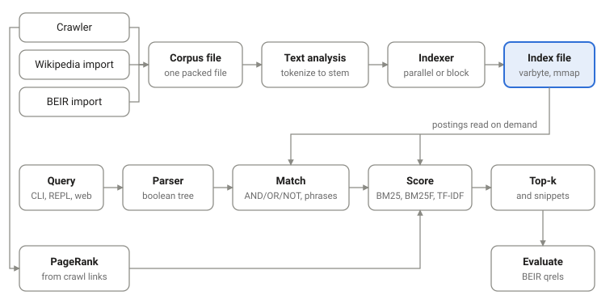

# A Search Engine for the Web

Crawling, link analysis and ranking, written from scratch in C++20. No Lucene,
no Elasticsearch, no third-party index, tokenizer or ranking library. The
dependencies are the C++ standard library, POSIX `mmap`, and libcurl, which is
optional and used only by the crawler.

Course project for **CS F469 Information Retrieval**, Group 3.

| ID            | Name                     |
| ------------- | ------------------------ |
| 2023A7PS0562P | Nainika Kalra            |
| 2023B2A71017P | Dhayanidhi Purushothaman |
| 2023B2A70935P | Rohan S                  |

## What it does today

```console
$ ./build/search wiki-import simplewiki.json.gz simplewiki.corpus
$ ./build/search index-write --threads 8 simplewiki.corpus simplewiki.idx
$ ./build/search query --snippet simplewiki.idx 'solar system'
1. doc_00015284  15.9926
   ...Renewable energy Renewable resource [Solar] power "[Solar] [systems]
   projects"...
```

## IR pipeline

Everything is written from scratch in C++20. The only external dependencies are the standard library, POSIX `mmap`, and libcurl for the crawler's HTTP fetches.

### Data and preprocessing

Wikipedia comes from the CirrusSearch dump (Simple English, 278,214 articles). BEIR datasets are read from their `corpus.jsonl`. Both importers write the same packed corpus format (one file with a table of offsets), so reading a document is a seek and not an `open` call. Crawled pages go through an HTML scanner that drops script and style tags, turns block tags into whitespace, and keeps the links for the link graph.

### Text analysis

Text is split on whitespace, and compounds are split again at hyphens, slashes and dashes, so `COVID-19` indexes as `covid` and `19`. Each token keeps its position and byte offset. Tokens are then lowercased, stripped of punctuation and folded from Latin-1 and Latin Extended-A to plain ASCII. Stopwords are removed after that, and what is left goes through the Porter stemmer.

### Indexing

A positional inverted index stores (doc id, term frequency, positions) for each term. Doc ids and positions are stored as gaps and variable-byte encoded. The corpus is split into slices that are indexed on separate threads, then merged in slice order, so the file is byte-identical regardless of the thread count. For corpora larger than memory, `index-build` indexes a block of documents at a time and merges the blocks in one pass over sorted term streams; its output is byte-identical to the in-memory build. `index-update` re-indexes only the documents whose content hash changed. Opening an index is an mmap plus a header read, finding a term is a binary search, and a postings list is decoded only when a query needs it.

### Retrieval and ranking

Queries are parsed into a boolean tree (binding: NOT > AND > OR). Matched documents are then scored with BM25 as the main scorer (k1 = 1.2, b = 0.75) and TF-IDF as the baseline. BM25F splits each term's frequency into title and body by position, normalizes each by its own field length, and weights the title twice the body before saturating. Scoring is sharded by document rather than by term for fault tolerance. Top-k uses a min-heap. Snippets are cut from the original text using the stored byte offsets. A misspelled query term gets a "did you mean" from a BK-tree over the dictionary, and prefixes complete from a trie, both in the REPL and in `search serve`, a small HTTP front end with a search page and a JSON API.

### Link analysis

PageRank scores each page by how many pages link to it, and how important those pages are. We run it on the links the crawler found, using the usual settings (0.85 damping, 30 rounds). Pages with no outgoing links still pass on their score, and a page linking to the same page twice counts once.

With `--pagerank <w>` the text score is multiplied by 1 + w * ln(1 + N * pagerank), so link authority reorders matching documents but never adds a non-matching one. The graph can be pages, sites (each site's score given to its home page), or a flat boost to every home page as a control, and `--pagerank-max-words` limits it to short queries. The crawler fetches from many hosts in parallel while spacing requests to each one, caps pages per host, and can stay under a path prefix.

## Architecture



The top row builds the index, the middle row answers queries against it, and
the bottom row is link analysis and evaluation. PageRank scores, when a weight
is given, multiply the text score at query time.

## Results so far

Measured on an Apple M2 laptop (8 cores). Every number comes from a command in
this repository, see [SETUP.md](SETUP.md).

**Retrieval quality** on BEIR SciFact (5,183 abstracts, 300 test queries):

| Scorer            | nDCG@10   | P@5       | P@10      | R@10      | R@100     | F1@10     | MRR@10    | MAP       |
| ----------------- | --------- | --------- | --------- | --------- | --------- | --------- | --------- | --------- |
| TF-IDF (baseline) | 0.659     | 0.161     | 0.088     | 0.802     | 0.913     | 0.156     | 0.620     | 0.614     |
| BM25              | 0.685     | 0.163     | 0.091     | 0.824     | **0.925** | 0.162     | 0.645     | 0.641     |
| BM25F             | **0.693** | **0.164** | **0.091** | **0.827** | **0.925** | **0.163** | **0.656** | **0.650** |

BM25F matches or beats BM25, and BM25 beats TF-IDF, on every metric. Both BM25
scorers are above the 0.665 published for Lucene BM25 in the BEIR paper. Precision@10 looks
low because 277 of the 300 queries have exactly one relevant document, so the
best possible score on this set is 0.113.

On BEIR TREC-COVID (171,331 documents, 50 queries) nDCG@10 is 0.663 with BM25
and 0.685 with BM25F, against 0.656 published for BM25. It first measured 0.303:
the queries were split differently from the documents, so `COVID-19` never
matched, and nDCG used exponential gain where `trec_eval` uses linear.

**PageRank** lowered MRR@10 at every weight on a crawl of three documentation
sites (2,424 pages), because inside a site the best-linked pages are the indexes
in every navigation bar. On a crawl of 1,096 independent sites, ranking sites
instead of pages raised home-page finding from 0.565 to 0.775. A control that
gave every home page the same boost, with no links at all, reached 0.851, so
most of that gain is preferring home pages. Link authority stays off by default.

**Time and memory** on Simple English Wikipedia (278,214 articles, 425 MB of
text, 1.44 million distinct terms). Query figures are 25 keyword, boolean and
phrase queries, 5 runs each, with the index already in memory.

| Measurement                                | Value                                            |
| ------------------------------------------ | ------------------------------------------------ |
| Index build, 1 thread / 8 threads          | 43.9 s / 15.5 s (2.8x faster)                    |
| Index size, uncompressed / delta + varbyte | 1,025 MB / 188 MB (5.5x smaller)                 |
| Peak memory, building / serving            | 2.61 GB / 98 MB                                  |
| Startup to first answer                    | 56 ms                                            |
| Query latency p50 / p95 / p99              | 4.1 / 41.7 / 46.0 ms (p50 with snippets: 6.2 ms) |

The serial merge takes 4.3 s of the 15.5 s build, which is why 8 threads give
2.8x and not more.

## Status

Done: importers, text analysis, the compressed positional index with parallel
build and mmap loading, boolean and phrase queries, TF-IDF, BM25 and BM25F
ranking with snippets, a block-based build for indexes larger than memory,
incremental re-indexing by content hash, BEIR evaluation on SciFact and
TREC-COVID, a parallel crawler run against real sites, PageRank mixed into the
text score, spelling correction and autocomplete, and a browser front end.

Not done: WAND pruning for OR queries, which is only worth it if profiling
shows scoring and not decoding is the cost.

## Who did what

| Member                   | Area                 | Components                                                                                                                                                                                                               |
| ------------------------ | -------------------- | ------------------------------------------------------------------------------------------------------------------------------------------------------------------------------------------------------------------------ |
| Rohan S                  | Storage and indexing | Corpus file format, Wikipedia and BEIR importers, positional inverted index with delta and varbyte compression, memory-mapped index format, parallel build with a thread pool, BEIR evaluation metrics, benchmark script |
| Nainika Kalra            | Text and query       | Tokenizer, normalization, stopword removal, Porter stemmer, query parser, boolean and phrase matching, TF-IDF and BM25 scoring, top-k selection, snippets, interactive search prompt                                     |
| Dhayanidhi Purushothaman | Crawler and PageRank | URL queue and normalization, robots.txt and crawl delays, per-site rate limiting, HTML to text, duplicate detection, link graph output, PageRank over that graph                                                         |

## Building

Needs CMake 3.20 or newer and a C++20 compiler. libcurl is optional.

```console
$ cmake -S . -B build && cmake --build build -j
```

[SETUP.md](SETUP.md) goes from a fresh clone to a Wikipedia index.
[COMMANDS.md](COMMANDS.md) lists the common commands, and `./build/search` with
no arguments prints all of them.
