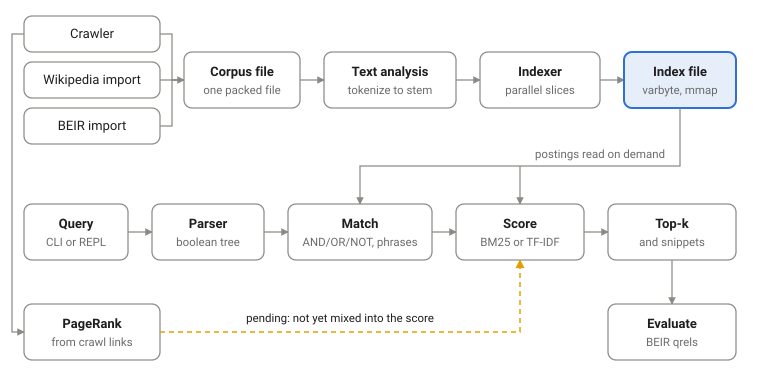

# A Search Engine for the Web

Crawling, link analysis and ranking, written from scratch in C++20. No Lucene,
no Elasticsearch, no third-party index, tokenizer or ranking library. The
dependencies are the C++ standard library, POSIX `mmap`, and libcurl, which is
optional and used only by the crawler.

Course project for **CS F469 Information Retrieval**, Group 3.

| ID            | Name                     |
| ------------- | ------------------------ |
| 2023A7PS0562P | Nainika Kalra            |
| 2023B2A71017P | Dhayanidhi Purushothaman |
| 2023B2A70935P | Rohan S                  |

## What it does today

```console
$ ./build/search wiki-import simplewiki.json.gz simplewiki.corpus
$ ./build/search index-write --threads 8 simplewiki.corpus simplewiki.idx
$ ./build/search query --snippet simplewiki.idx 'solar system'
1. doc_00015284  16.1311
   ...Renewable energy Renewable resource [Solar] power "[Solar] [systems]
   projects"...
```

## IR pipeline

Everything is written from scratch in C++20. The only external dependencies are the standard library, POSIX `mmap`, and libcurl for the crawler's HTTP fetches.

### Data and preprocessing

Wikipedia comes from the CirrusSearch dump (Simple English, 278,214 articles). BEIR datasets are read from their `corpus.jsonl`. Both importers write the same packed corpus format (one file with a table of offsets), so reading a document is a seek and not an `open` call. Crawled pages go through an HTML scanner that drops script and style tags, turns block tags into whitespace, and keeps the links for the link graph.

### Text analysis

Text is split on whitespace, and each token keeps its position and byte offset. Tokens are then lowercased, stripped of punctuation and folded from Latin-1 and Latin Extended-A to plain ASCII. Stopwords are removed after that, and what is left goes through the Porter stemmer.

### Indexing

A positional inverted index stores (doc id, term frequency, positions) for each term. Doc ids and positions are stored as gaps and variable-byte encoded. The corpus is split into slices that are indexed on separate threads, then merged in slice order, so the file is byte-identical regardless of the thread count. Opening an index is an mmap plus a header read, finding a term is a binary search, and a postings list is decoded only when a query needs it.

### Retrieval and ranking

Queries are parsed into a boolean tree (binding: NOT > AND > OR). Matched documents are then scored with BM25 as the main scorer (k1 = 1.2, b = 0.75) and TF-IDF as the baseline. Scoring is sharded by document rather than by term for fault tolerance. Top-k uses a min-heap. Snippets are cut from the original text using the stored byte offsets.

### Link analysis

PageRank scores each page by how many pages link to it, and how important those pages are. We run it on the links the crawler found, using the usual settings (0.85 damping, 30 rounds). Pages with no outgoing links still pass on their score, and a page linking to the same page twice counts once.

## Architecture



The top row builds the index, the middle row answers queries against it, and
the bottom row is link analysis and evaluation. PageRank already runs over the
crawler's link graph, but its scores are not yet mixed into the ranking.

## Results so far

Measured on an Apple M2 laptop (8 cores). Every number comes from a command in
this repository, see [SETUP.md](SETUP.md).

**Retrieval quality** on BEIR SciFact (5,183 abstracts, 300 test queries):

| Scorer            | nDCG@10   | P@5       | P@10      | R@10      | R@100     | F1@10     | MRR@10    | MAP       |
| ----------------- | --------- | --------- | --------- | --------- | --------- | --------- | --------- | --------- |
| TF-IDF (baseline) | 0.632     | 0.156     | 0.086     | 0.785     | 0.904     | 0.153     | 0.591     | 0.583     |
| BM25              | **0.671** | **0.162** | **0.090** | **0.813** | **0.913** | **0.160** | **0.632** | **0.626** |

BM25 beats TF-IDF on every metric, and its nDCG@10 is in line with the 0.665
published for Lucene BM25 in the BEIR paper. Precision@10 looks low because 277
of the 300 queries have exactly one relevant document, so the best possible
score on this set is 0.113.

**Time and memory** on Simple English Wikipedia (278,214 articles, 425 MB of
text, 1.44 million distinct terms). Query figures are 25 keyword, boolean and
phrase queries, 5 runs each, with the index already in memory.

| Measurement                                | Value                                            |
| ------------------------------------------ | ------------------------------------------------ |
| Index build, 1 thread / 8 threads          | 43.9 s / 15.5 s (2.8x faster)                    |
| Index size, uncompressed / delta + varbyte | 1,025 MB / 188 MB (5.5x smaller)                 |
| Peak memory, building / serving            | 2.61 GB / 98 MB                                  |
| Startup to first answer                    | 56 ms                                            |
| Query latency p50 / p95 / p99              | 4.1 / 41.7 / 46.0 ms (p50 with snippets: 6.2 ms) |

The serial merge takes 4.3 s of the 15.5 s build, which is why 8 threads give
2.8x and not more. Peak build memory is 2.6 GB for a 425 MB corpus, which is why
the block-based build is next.

## Status

Most of the system works: importers, text analysis, the compressed positional
index with parallel build and mmap loading, boolean and phrase queries, TF-IDF
and BM25 ranking with snippets, BEIR evaluation, the crawler, and PageRank as a
separate step.

Still to do before the final submission:

- Crawl a few thousand real pages from sites whose robots.txt allows it.
- Mix PageRank into the BM25 score.
- A block-based external build, checked byte for byte against the in-memory
  build.
- A TREC-COVID evaluation, compared with the published BEIR BM25 numbers.

Stretch objectives, none started yet: spelling correction (BK-tree) and
autocomplete (trie) in the REPL, BM25F-style title weighting, incremental
re-indexing by content hash, and a small HTTP front end for the demo. WAND
pruning for OR queries only if profiling shows scoring and not decoding is the
cost.

## Who did what

| Member                   | Area                 | Components                                                                                                                                                                                                               |
| ------------------------ | -------------------- | ------------------------------------------------------------------------------------------------------------------------------------------------------------------------------------------------------------------------ |
| Rohan S                  | Storage and indexing | Corpus file format, Wikipedia and BEIR importers, positional inverted index with delta and varbyte compression, memory-mapped index format, parallel build with a thread pool, BEIR evaluation metrics, benchmark script |
| Nainika Kalra            | Text and query       | Tokenizer, normalization, stopword removal, Porter stemmer, query parser, boolean and phrase matching, TF-IDF and BM25 scoring, top-k selection, snippets, interactive search prompt                                     |
| Dhayanidhi Purushothaman | Crawler and PageRank | URL queue and normalization, robots.txt and crawl delays, per-site rate limiting, HTML to text, duplicate detection, link graph output, PageRank over that graph                                                         |

## Building

Needs CMake 3.20 or newer and a C++20 compiler. libcurl is optional.

```console
$ cmake -S . -B build && cmake --build build -j
```

[SETUP.md](SETUP.md) goes from a fresh clone to a Wikipedia index.
[COMMANDS.md](COMMANDS.md) lists the common commands, and `./build/search` with
no arguments prints all of them.
